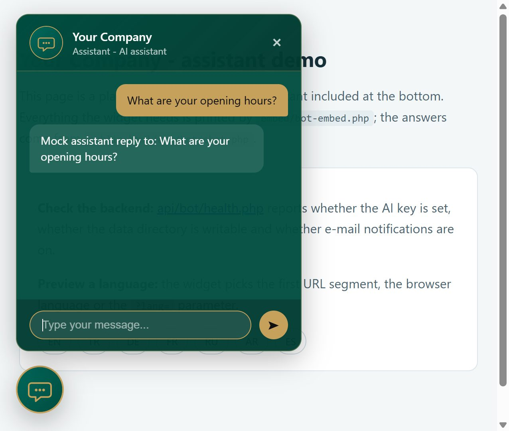

# website-bot

A drop-in AI support assistant for any website: a floating chat widget, a small
PHP backend, multilingual UI and lead capture.

- No build step, no framework, no composer dependencies — plain PHP 8 + jQuery-free JS
- Works from a single include line (PHP) or three tags (any static site)
- Any OpenAI-compatible endpoint: Groq, OpenAI, OpenRouter, Together, a local vLLM/Ollama gateway
- 28 UI languages, automatic language detection, RTL support
- Lead capture: JSON log + optional e-mail card, rate limiting, no key ever reaches the browser

**The only required setting is `AI_API_KEY`.** Everything else has a working default.



---

## Quick start

```bash
git clone https://github.com/<you>/website-bot.git
cd website-bot
cp .env.example .env        # then set AI_API_KEY
php -S 127.0.0.1:8123 -t public_html
```

Open <http://127.0.0.1:8123> — the landing page shows the widget and the setup status.
`/api/bot/health.php` reports what is configured (it never exposes secrets).

## Layout

`public_html` is the document root; everything else must sit **next to** it:

```
website-bot/
├── public_html/          <- document root
│   ├── index.php         landing page (demo only, delete in production)
│   ├── demo.php          PHP include demo
│   ├── demo.html         static HTML demo
│   ├── assets/           widget JS, CSS, avatar
│   └── api/bot/          chat.php, health.php, lead.php
├── core/                 ChatHandler, lead worker, mailer, bootstrap
├── config/               bot_config.php, env_loader.php
├── embed/                bot-embed.php (one-line PHP include)
├── tests/                mock AI endpoint + smoke test
├── data/                 leads, locks, logs (writable, kept out of the web root)
├── .env.example
└── README.md
```

## Add it to a site

### PHP

Before `</body>`:

```php
<?php $botLang = $lang ?? 'en'; include '/path/to/embed/bot-embed.php'; ?>
```

### Any site (static HTML, WordPress, Shopify…)

```html
<script>
  window.BOT_WIDGET_CONFIG = {
    brandName: "Your Company",
    assistantName: "Assistant",
    apiChat: "https://your-server.com/api/bot/chat.php",
    lang: document.documentElement.lang || "en"
  };
</script>
<link rel="stylesheet" href="https://your-server.com/assets/css/bot-widget.css">
<script src="https://your-server.com/assets/js/bot-widget.js" defer></script>
```

Cross-origin? Set `BOT_CORS_ORIGIN=https://yoursite.com` in `.env`.
Installed in a sub-directory? Set `BOT_ASSET_BASE` and `BOT_API_BASE`.

## Configuration

Everything lives in `.env` (see `.env.example`) or `config/bot_config.php`.

| Group | Keys |
| --- | --- |
| AI | `AI_API_KEY`, `AI_BASE_URL`, `AI_MODEL`, `AI_MAX_TOKENS`, `AI_TEMPERATURE`, `AI_TIMEOUT`, `AI_SSL_VERIFY` |
| Branding | `BOT_BRAND_NAME`, `BOT_ASSISTANT_NAME`, `BOT_ASSISTANT_ROLE`, `BOT_SUBTITLE`, `BOT_AVATAR`, `BOT_COLOR_PRIMARY`, `BOT_COLOR_ACCENT` |
| Widget | `BOT_DEFAULT_LANG`, `BOT_POSITION`, `BOT_AUTO_OPEN`, `BOT_OPEN_DELAY`, `BOT_MAX_INPUT`, `BOT_ASSET_BASE`, `BOT_API_BASE`, `BOT_CORS_ORIGIN` |
| Leads | `BOT_STORE_LEADS`, `LEAD_NOTIFY_EMAIL`, `BOT_INTERNAL_KEY`, `BOT_RATE_LIMIT`, `BOT_RATE_WINDOW`, `BOT_LEAD_DEDUPE`, `BOT_KEEP_LEADS` |
| Mail | `SMTP_HOST`, `SMTP_PORT`, `SMTP_USER`, `SMTP_PASS`, `FROM_EMAIL`, `FROM_NAME` |
| Prompt | `BOT_EXTRA_PROMPT` (appends rules), `BOT_SYSTEM_PROMPT` (replaces the generated prompt) |

### UI strings

`public_html/assets/js/bot-widget.js` → `var I18N = { ... }`. Every string supports the
`{brand}` and `{assistant}` placeholders. To override a language from a single page without
touching the file:

```js
window.BOT_WIDGET_CONFIG = {
  strings: { en: { welcome: "Hi! How can we help?" } }
};
```

Languages: `tr en ru ky az ar fa de fr es it uz kk ro bg sq sr nl pl cs da el fi fr-ma hu no pt sv`.
Remove unused ones from `config/bot_config.php` → `languages` (a smaller list means less work
for the browser).

## Endpoints

| Endpoint | Method | Purpose |
| --- | --- | --- |
| `/api/bot/chat.php` | `POST` | `{message, lang, url, title, history}` → `{reply, is_final, lead_details}` |
| `/api/bot/chat.php?action=get_lang` | `GET` | browser language hint |
| `/api/bot/health.php` | `GET` | setup status, no secrets |
| `/api/bot/lead.php` | `POST` | server-to-server lead push, requires `X-Internal-Key` |

## Leads

- Every turn is appended to `data/bot_leads.json` (`BOT_STORE_LEADS=false` disables this).
- When the visitor leaves a phone number or e-mail address, the turn is marked `is_final`
  and a lead card e-mail is sent to `LEAD_NOTIFY_EMAIL`.
- E-mail is **off by default** (`LEAD_NOTIFY_EMAIL` empty): leads are still stored.
- `data/` must be writable and must stay outside the document root.
- `php -l`-clean, no database required.

## Tests

```bash
# terminal 1: fake OpenAI-compatible server for local runs
php -S 127.0.0.1:8124 tests/mock_ai.php

# terminal 2: the app, pointed at the fake server
AI_BASE_URL=http://127.0.0.1:8124/v1 AI_API_KEY=test php -S 127.0.0.1:8123 -t public_html

# terminal 3
php tests/smoke.php http://127.0.0.1:8123
```

PowerShell equivalent for the second line:

```powershell
$env:AI_BASE_URL='http://127.0.0.1:8124/v1'; $env:AI_API_KEY='test'; php -S 127.0.0.1:8123 -t public_html
```

## Requirements

- PHP 8.0+ with `json` (bundled). `curl` or `openssl` is needed for real HTTPS AI calls —
  most hosts ship both.
- A writable `data/` directory.
- Any OpenAI-compatible `/chat/completions` API.

## Security

- The API key stays server-side; the browser only sees `api/bot/chat.php`.
- Rate limit per IP, default 20 requests / 60 s.
- `.env` is git-ignored; no credentials are shipped in the repository.
- `lead.php` refuses every request until `BOT_INTERNAL_KEY` is set.
- `AI_SSL_VERIFY=true` by default — only disable it for a self-signed internal endpoint.

## License

MIT — see [LICENSE](LICENSE).
